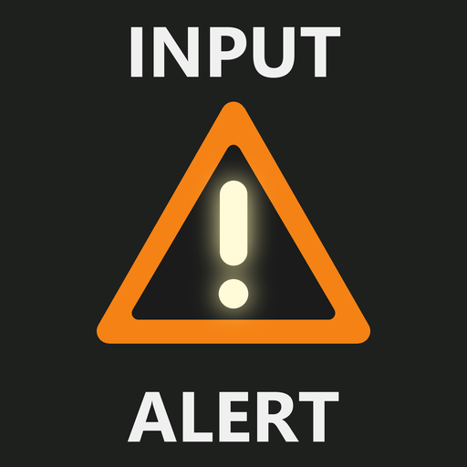

  

  

<h1 align="center">Input Alert</h1>

  
  
  

  <b>See at a glance which production inputs are running out.</b> 
  by PropaineX

  

Everything shows in the game's own **Production Chains** menu:

- **Incoming materials**: every material a switched-on product needs is highlighted in soft red when it is at
  **10% of its capacity or less**. Materials that only switched-off products use are left alone.
- **Recipe status boxes**: pick a product and every input in its recipe gets a box to the left of its icon:
  - green tick: plenty in storage (10 or more production cycles)
  - yellow plus: okay, nothing to do yet (2 to 10 cycles)
  - red X: low or empty (under 2 cycles), deliver this

Works with base game, map and mod productions. Read only: it changes nothing in your productions, sends no network
traffic of its own and adds no hotkeys. Multiplayer and dedicated servers are supported (it reads the storage levels
the game already sends to every player).

  

Put `FS25_InputAlert.zip` in `Documents/My Games/FarmingSimulator2025/mods`, without unzipping or renaming it.
In multiplayer, install it on the server **and** on every player's game, all on the same version.

In the log, look for lines starting with `[InputAlert]`.

See [PATCH_NOTES.md](PATCH_NOTES.md) for what changed in each version.

## How it works (for modders)

- `scripts/InputAlertMenu.lua` is appended to `InGameMenuProductionFrame.draw`. The menu's own code is not public,
  so the rows are found by their text and the boxes and highlights are drawn on top.
- Thresholds at the top of the script: `InputAlert.LOW_CYCLES` (2), `InputAlert.GOOD_CYCLES` (10),
  `InputAlert.LOW_PERCENT` (0.10).
- Does not hook `ProductionPoint.load`.
- Passes the GIANTS TestRunner 0.9.24.

  

MIT, see [LICENSE](LICENSE).

---

   
  Part of <a href="https://github.com/DTM-Mods">DTM Mods</a> (Designed To Manage) by PropaineX & Fennell

